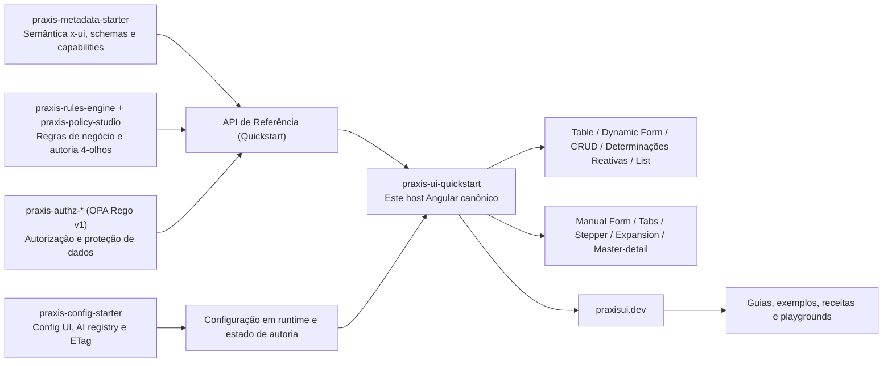
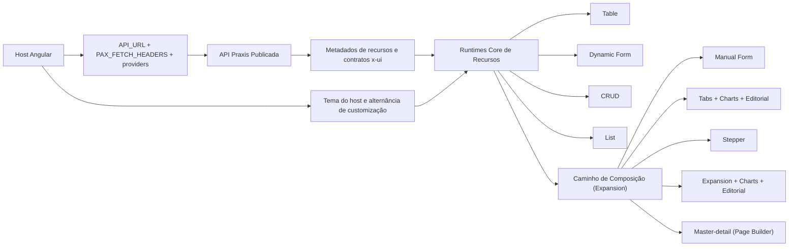

# Praxis UI Quickstart

Host Angular 21 canônico para o primeiro caminho de adoção do **PraxisUI** — o runtime oficial de interface da [**Praxis Platform**](https://praxisui.dev/) (uma plataforma semanticamente orientada para aplicações corporativas *AI-native*, em que recursos, regras, ações, dados e políticas são descritos uma única vez e operados por interfaces tradicionais, interfaces generativas, agentes de IA e integrações).

[](https://angular.dev/)
[](https://praxisui.dev)
[](https://praxis-ui-4e602.web.app)
[](./package.json)

Este repositório é o menor caminho entre o zero e um host Angular corporativo conectado à plataforma Praxis. Ele serve como prova instalável de que uma aplicação Angular consegue inicializar o PraxisUI com pacotes publicados (`@praxisui/*` `10.0.0-rc.43`), apontar para a API publicada, propagar headers de tenant/idioma, manter **100% da posse visual** no host e renderizar telas guiadas por metadados sem atalhos locais.

Este host **não** substitui o catálogo completo de componentes nem é a fonte canônica de metadados ou políticas: o quickstart prova o caminho de adoção em uma aplicação consumidora; o portal [praxisui.dev](https://praxisui.dev/) publica a documentação e os playgrounds completos; e os starters/motores backend detêm a semântica de domínio, configuração, autorização e regras.

---

## Links relacionados

- [Portal oficial PraxisUI](https://praxisui.dev)
- [API publicada de Quickstart](https://praxis-api-quickstart.onrender.com/api)
- [Repositório do Quickstart](https://github.com/codexrodrigues/praxis-ui-quickstart)
- [Aplicação publicada (Live Quickstart)](https://praxis-ui-4e602.web.app)
- [Contrato oficial de host](./docs/official-host-contract.md)
- [Runbook de provisionamento em produção](./docs/production-host-provisioning.md)
- [Política de CI e publicação](./ACTIONS-RELEASE-POLICY.md)
- [Inventário legível por máquina (`examples.manifest.json`)](./public/examples.manifest.json)

---

## Qual problema o Praxis resolve e papel no ecossistema

Em sistemas corporativos convencionais, cada nova entidade de negócio exige reescrever manualmente o mesmo conhecimento em múltiplas camadas: modelo no banco, DTOs REST, validações no backend, formulários reativos no frontend, colunas de tabela, filtros combinados, combos de relacionamento, máscaras, fluxos de aprovação e regras de exibição. Plataformas *low-code* tradicionais ou ferramentas de BI tentam encurtar esse caminho prendendo a empresa a editores proprietários ou visuais engessados.

Na **Praxis Platform**, essa semântica é declarada uma única vez em metadados e contratos determinísticos — trazendo ganhos diretos de **economia de tokens em IA e velocidade de entrega**:

- **Zero duplicação entre frontend e backend:** O mesmo `resourcePath` (`human-resources/funcionarios`, `human-resources/folhas-pagamento`, `human-resources/eventos-folha`, etc.) alimenta tabela, formulário dinâmico, CRUD, lista e visões compostas sem redeclarar campos no Angular.
- **Economia drástica de tokens de IA e maior precisão de agentes:** Quando um agente de IA ou fluxo generativo precisa criar ou operar uma tela corporativa, ele não consome dezenas de arquivos HTML/TS e serviços HTTP arbitrários na janela de contexto — basta ler o schema filtrado (`GET /schemas/filtered`), as capabilities e o manifesto declarativo dos pacotes `@praxisui/*`.
- **Regras no servidor, UX reativa no navegador:** Em vez de vazar regras financeiras ou tributárias para JavaScript no cliente, determinações em tempo de preenchimento (`x-ui.reactiveDeterminations`) executam no backend e retornam prévia autoritativa, trilha de proveniência e diagnóstico seguro para a UI.



### Fontes canônicas e projetos relacionados da plataforma

| Repositório / Projeto | O que faz na Plataforma Praxis | Por que importa para este Quickstart |
| --- | --- | --- |
| [`praxis-metadata-starter`](https://github.com/codexrodrigues/praxis-metadata-starter) | Gera schemas estruturais (`/schemas/filtered`), vocabulário `x-ui`, filtros dinâmicos, `@UiSurface`, `@WorkflowAction`, `capabilities` e `/schemas/domain` | É a fonte de metadados que permite aos componentes deste quickstart renderizarem formulários, tabelas e ações sem hardcode |
| [`praxis-config-starter`](https://github.com/codexrodrigues/praxis-config-starter) & [`praxis-config-contracts`](https://github.com/codexrodrigues/praxis-config-contracts) | Plano de controle (PAP) para `ui_user_config` com `ETag`, `ai_registry`, grounding RAG, streaming e ciclo de vida de regras | Sustenta a personalização em tempo de execução, preferências de layout e serviços de autoria |
| [`praxis-rules-engine`](https://github.com/codexrodrigues/praxis-rules-engine) | Motor Java 21 puro e determinístico em 5 estados para JSON Logic (`decisionKind = BUSINESS`) | Garante avaliação idêntica de regras de negócio declarativas sem dependência de framework |
| [`praxis-authz-contracts`](https://github.com/codexrodrigues/praxis-authz-contracts) · [`praxis-authz-enforcement-core`](https://github.com/codexrodrigues/praxis-authz-enforcement-core) · [`praxis-authz-opa`](https://github.com/codexrodrigues/praxis-authz-opa) · [`praxis-authz-starter`](https://github.com/codexrodrigues/praxis-authz-starter) | Família de autorização declarativa baseada em OPA Rego v1, escopo SQL 3VL e mascaramento server-side (`decisionKind = AUTHORIZATION`) | Impede vazamento de dados e valida permissões no backend independentemente da UI |
| [`praxis-policy-studio`](https://github.com/codexrodrigues/praxis-policy-studio) | Estação visual com aprovação 4-olhos (**Lente de Regras de Negócio** e **Lente de Acesso e Proteção de Dados**) | Permite governar, simular e publicar políticas consumidas pelo runtime |
| [`praxis-file-management`](https://github.com/codexrodrigues/praxis-file-management) | Starter de upload seguro (Apache Tika *magic number*, rate limit, cotas, lote e pré-assinatura) | Integra-se ao pacote `@praxisui/files-upload` já presente no grafo do `@praxisui/*` |
| [`praxisui-http-examples`](https://github.com/codexrodrigues/praxisui-http-examples) | Corpus canônico de provas HTTP, payloads, capabilities e determinações reativas | Documenta na prática as requisições reais executadas por fluxos como o deste quickstart |
| [`praxis-hero-hq-ui`](https://github.com/codexrodrigues/praxis-hero-hq-ui) | Vitrine corporativa completa multi-domínio e laboratório visual avançado | Demonstra cenários complexos em produção além do caminho inicial deste quickstart |
| [`praxis-ui-angular`](https://github.com/codexrodrigues/praxis-ui-angular) & [`praxis-api-quickstart`](https://github.com/codexrodrigues/praxis-api-quickstart) | Monorepo dos 22 pacotes Angular `@praxisui/*` e backend de referência publicado no Render | Fornecem respectivamente os pacotes npm consumidos e a API operacional |

---

## O que este repositório comprova

- Bootstrap oficial de uma aplicação Angular standalone (`21.2.20`)
- `API_URL` apontando para a API publicada do `praxis-api-quickstart`
- `PAX_FETCH_HEADERS` propagando tenant e locale nas chamadas
- Conjunto completo de **22 pacotes `@praxisui/*` compatíveis com Angular 21** fixados na versão exata `10.0.0-rc.43`
- Cinco exemplos principais (**Core**) provando recursos reais em fluxo contínuo (`Table`, `Dynamic Form`, `CRUD`, `Reactive Determinations`, `List`)
- Cinco exemplos de composição (**Composition**) cobrindo `Manual Form`, `Tabs`, `Stepper`, `Expansion` (com `@praxisui/charts` e `@praxisui/editorial-forms` embarcados) e `Master-detail` (`@praxisui/page-builder`)
- Alternância de customização em tempo de execução a partir do shell do host
- Posse total de tema e identidade visual pelo host sobre o runtime compartilhado

---

## Caminho de leitura e exemplos incluídos

O quickstart é organizado em duas camadas alinhadas ao inventário oficial em [`public/examples.manifest.json`](./public/examples.manifest.json):

### 1. Camada Core (caminho inicial recomendado)

1. **`praxis-table`** (`/examples/table`) — leitura de coleção paginada e filtragem orientada ao schema de `human-resources/funcionarios`
2. **`praxis-dynamic-form`** (`/examples/form`) — hidratação, layout e submissão guiados por metadados de `human-resources/funcionarios`
3. **`praxis-crud`** (`/examples/crud`) — orquestração unificada de tabela + formulário em fluxo CRUD governado
4. **`reactive-determinations`** (`/examples/reactive-determinations`) — decisões reativas em tempo de formulário sobre `human-resources/enderecos`, `human-resources/folhas-pagamento` e `human-resources/eventos-folha`
5. **`praxis-list`** (`/examples/list`) — leitura alternativa da mesma coleção publicada em formato de lista

### 2. Camada de Composição (`Expansion`)

1. **`praxis-manual-form`** (`/examples/manual-form`) — campos manuais ligados à ponte de metadados (`@praxisui/manual-form` + `@praxisui/dynamic-fields`)
2. **`praxis-tabs`** (`/examples/tabs`) — abas com `@praxisui/charts` e `@praxisui/editorial-forms` embarcados
3. **`praxis-stepper`** (`/examples/stepper`) — fluxo multi-etapas com `@praxisui/stepper` e `@praxisui/dynamic-form`
4. **`praxis-expansion`** (`/examples/expansion`) — painéis expansíveis compondo `@praxisui/charts` e `@praxisui/editorial-forms`
5. **`master-detail`** (`/examples/master-detail`) — composição mestre-detalhe gerida pelo runtime de `@praxisui/page-builder`

Além dos 10 exemplos do manifesto oficial, o roteador ([`src/app/app.routes.ts`](./src/app/app.routes.ts)) registra rotas de recursos genéricos (`PraxisResourcePage` em `/resources/funcionarios`, `/resources/departamentos` e `/resources/cargos`) e páginas dinâmicas (`/studio/:studioKey` e `/pages/:pageId`).

---

## Determinações Reativas: o fluxo completo de decisão em formulário

Acesse `/examples/reactive-determinations` após conhecer o formulário dinâmico básico. O exemplo demonstra decisões pertencentes ao backend sem embutir regras de negócio em código Angular:

- preenchimento de CEP determina campos de endereço;
- valor bruto e descontos determinam o valor líquido, e esse valor líquido autoritativo participa da determinação da data de pagamento.

O schema de requisição publica `x-ui.reactiveDeterminations`, contendo apenas identificadores estáveis de operação, gatilhos, bindings de entrada/saída, escopo e proveniência. **Não** são publicadas fórmulas executáveis, URLs arbitrárias, headers nem políticas locais de patch no frontend.

A página separa explicitamente três responsabilidades:

1. **`PraxisDynamicForm`** executa a capability compilada a partir dos metadados e gerencia o ciclo de vida dos campos derivados transitórios.
2. **O host** observa `reactiveDeterminationExecuted` e `reactiveDeterminationPendingChange` apenas para feedback de UX e diagnóstico seguro.
3. **`ReactiveDeterminationDiagnosticsComponent`** exibe o schema de requisição e eventos livres de valores sensíveis em modo somente leitura — qualquer alteração de regra de negócio pertence à autoria governada no backend/Config.

O caminho autenticado consulta `/auth/session`, mantém os formulários desabilitados quando não há principal autenticado e fornece um login mínimo de demonstração com sessão `HttpOnly` enviada exclusivamente à origem de `API_URL`. O interceptor [`praxis-api-credentials.interceptor.ts`](./src/app/praxis-api-credentials.interceptor.ts) só anexa `withCredentials` (e cabeçalho CSRF `X-XSRF-TOKEN`) para a origem configurada em `API_URL`, sem expor tokens JWT ao código Angular. Em um host corporativo real, substitua o login de demonstração pelo IdP/BFF da organização.

A submissão permanece bloqueada enquanto houver determinação pendente ou quando a geração mais recente não produzir rascunho autoritativo, e o fluxo falha fechado (*fail-closed*) caso o schema não possa ser carregado (`401/403` principal ausente ou não autorizado, `422` fonte não determinável, `503` decisão ou snapshot indisponível), sem jamais instalar fórmula local de fallback. Consulte também o registro operacional de homologação em [docs/payroll-g4-adoption.md](./docs/payroll-g4-adoption.md).

---

## Primeiros 10 minutos

1. Instale as dependências com `npm install`.
2. Inicie o host Angular em `http://127.0.0.1:4301` com `npm start`.
3. Confirme que o host consome a API publicada configurada em `src/app/app.config.ts`.
4. Navegue pelos exemplos `Table`, `Form`, `CRUD`, `Reactive Determinations` e `List`.
5. Verifique que `Table`, `Form`, `CRUD` e `List` reutilizam o mesmo `resourcePath` (`human-resources/funcionarios`).
6. Abra o menu `Expansion` e inspecione `Manual form`, `Tabs`, `Stepper`, `Expansion` e `Master-detail`.
7. Alterne a customização e os temas do host para confirmar que o runtime respeita o design system da aplicação.

---

## Início rápido (`Quick start`)

```bash
npm install
npm start
```

Abra no navegador: `http://127.0.0.1:4301`.

### Trem de dependências fixado (*Dependency Train*)

Este host é intencionalmente travado em versões exatas compatíveis entre si (verificado automaticamente por `npm run validate:official-host`):

- Framework/compiler Angular (`@angular/core`, etc.): `21.2.20`
- Angular Material e CDK (`@angular/material`, `@angular/cdk`): `21.2.14`
- Angular CLI / Build (`@angular/cli`, `@angular/build`): `21.2.21`
- Pacotes `@praxisui/*` (todos os 22 pacotes): `10.0.0-rc.43`

Preserve exatamente o conjunto de versões alinhadas ao atualizar; não substitua por *dist-tags* ou faixas abertas sem validar a *peer range* completa do Angular e toda a clausura dos pacotes `@praxisui/*`.

---

## Validação contra bibliotecas locais do `@praxisui/*`

Use este modo apenas quando precisar validar alterações ainda não publicadas em `../praxis-ui-angular/dist`:

```bash
npm run build:local-praxis
npm run start:local-praxis -- --host 127.0.0.1 --port 4301
```

Esse fluxo:

- gera `tsconfig.local-praxis.json` (não versionar);
- copia os artefatos compilados de `@praxisui/*` para `.local-praxis/node_modules/@praxisui/*`;
- mantém as dependências *peer* do Angular resolvidas pelo próprio quickstart;
- inicia o host na mesma origem oficial de validação (`http://127.0.0.1:4301`).

> **Observação:** compile primeiro as bibliotecas em `../praxis-ui-angular/dist` (`npm run watch-all` em `praxis-ui-angular`). Prefira esse modo a `npm link` pacote por pacote.

---

## Como funciona na prática



### Modo API pública

- **Origem:** `https://praxis-api-quickstart.onrender.com`
- **Base URL (`API_URL`):** `https://praxis-api-quickstart.onrender.com/api`
- **URL local de desenvolvimento:** `http://127.0.0.1:4301` (já permitida em CORS pela API publicada)

### Para adotantes externos

Este quickstart consome os pacotes `@praxisui/*` diretamente do registro npm público. Não é necessário acesso ao workspace fonte das bibliotecas nem orquestração local de build dos pacotes para subir e operar o host.

### Decisões canônicas de host

- `API_URL` já inclui o sufixo `/api`; os exemplos usam `resourcePath` relativo (ex.: `'human-resources/funcionarios'`).
- [`src/app/app.config.ts`](./src/app/app.config.ts) registra `provideHttpClient(...)`, providers dos módulos `@praxisui/*`, seed global (`GLOBAL_CONFIG_SEED`) e interceptors canônicos (incluindo fallback local para `/praxis/config/ui` apenas quando visitantes anônimos recebem `0/401/403/404/502/503/504`, preservando `ETag`).
- Tenant e locale trafegam via `PAX_FETCH_HEADERS`.
- Os quatro exemplos iniciais compartilham a mesma superfície remota antes de avançar para os demais domínios já publicados na API de referência (`/api/human-resources/**`, `/api/operations/**`, `/api/assets/**`, `/api/risk-intelligence/**`).

### O host é dono do visual e do tema

A plataforma Praxis entrega interpretação de metadados, comportamento de runtime e customização governada; o host mantém autonomia total sobre cores/tokens, tipografia, espaçamento, densidade, marca e composição. O tema `Corporate` incluído neste quickstart demonstra explicitamente que é possível aplicar gradientes escuros, raios amplos e superfícies estilizadas sem interferir no funcionamento dos runtimes.

---

## Snippets dos exemplos principais

### Praxis Table

```html
<praxis-table
  tableId="quickstart-table"
  [resourcePath]="'human-resources/funcionarios'">
</praxis-table>
```

### Praxis Dynamic Form

No exemplo de leitura abaixo, `resourceId="1"` aponta para um registro de demonstração da API; em aplicações reais, substitua pelo ID da linha selecionada, parâmetro de rota ou estado do host (ou use `mode="create"` sem `resourceId` para criação):

```html
<praxis-dynamic-form
  [formId]="'quickstart-funcionarios'"
  [resourcePath]="'human-resources/funcionarios'"
  [resourceId]="1"
  [mode]="'view'">
</praxis-dynamic-form>
```

### Praxis CRUD e Praxis List

```html
<praxis-crud
  [crudId]="'quickstart-crud'"
  [metadata]="crudMetadata">
</praxis-crud>
```

```html
<praxis-list
  listId="quickstart-list"
  [config]="listConfig">
</praxis-list>
```

---

## Estrutura do projeto

- [`src/app/app.config.ts`](./src/app/app.config.ts) — bootstrap canônico do host, `API_URL`, providers Praxis e factory de headers
- [`src/app/app.routes.ts`](./src/app/app.routes.ts) — rotas de exemplos core, composição, recursos e Page Builder
- [`src/app/quickstart-content.ts`](./src/app/quickstart-content.ts) — passos de setup, snippets, constantes e catálogo
- [`src/app/pages/home-page.component.ts`](./src/app/pages/home-page.component.ts) — página inicial de onboarding
- [`src/app/app.html`](./src/app/app.html) — shell e navegação superior
- [`src/styles.scss`](./src/styles.scss) — ponte de temas controlada pelo host

---

## Validação e deploy

### Gates locais

```bash
npm run validate:official-host
npm run test:smoke
npm run build
```

Esses comandos verificam integridade de rotas, manifesto [`public/examples.manifest.json`](./public/examples.manifest.json), alinhamento exato do trem de versões (`Angular` + `@praxisui/*`), testes smoke em `ChromeHeadless` e build de produção.

### Deploy em produção (Firebase Hosting + GitHub Actions)

As configurações de hosting ficam em `.firebaserc` e `firebase.json` (destino `dist/praxis-ui-quickstart/browser`). Publicações em produção ocorrem **exclusivamente** via workflow oficial no GitHub Actions por despacho explícito em `main`:

```bash
gh workflow run "Deploy Production" --repo codexrodrigues/praxis-ui-quickstart --ref main
```

O workflow autentica via Google Workload Identity Federation (WIF), executa o gate de CI antes do deploy e valida o manifesto publicado, falhando fechado quando variáveis obrigatórias estão ausentes. Não utilize `firebase deploy` local nem chaves estáticas de service account; siga o runbook [docs/production-host-provisioning.md](./docs/production-host-provisioning.md).

---

## Solução de problemas rápida (*Troubleshooting*)

- **API remota não responde:** confirme que o host está em `http://127.0.0.1:4301` (origem permitida em CORS) e que `API_URL` aponta para `https://praxis-api-quickstart.onrender.com/api`.
- **Tema muda no shell mas não nos overlays:** o tema do host precisa alcançar a fronteira global de overlays (`cdk-overlay-container`); este quickstart já aplica a configuração global em nível de aplicação.
- **Instalação maior que o esperado no primeiro exemplo:** o grafo de `package.json` inclui pacotes *peer* de composição, autoria, gráficos, conteúdo rico e builder de regras além dos exemplos iniciais, todos fixados no trem `10.0.0-rc.43` para resolução determinística.

---

## Posicionamento e política de CI

O **PraxisUI** não se propõe aqui como uma simples biblioteca genérica de widgets: este quickstart demonstra um runtime governado e orientado a metadados para aplicações corporativas *AI-native*, hospedado em Angular e sincronizado com APIs backend reais.

Consulte [ACTIONS-RELEASE-POLICY.md](./ACTIONS-RELEASE-POLICY.md) para as diretrizes de economia de GitHub Actions, gatilhos de publicação e validação local.
